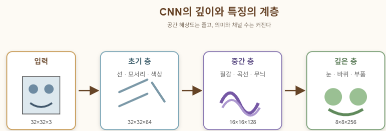

# Convolutional Neural Network
합성곱 신경망

이미지 분류를 위해 만들어진 신경망이다
( 예를들어 입력 이미지가 고양이인지, 자동차인지, 비행기인지 판단한다)

```
CNN
├─ VGG-style CNN
├─ VGG16
└─ ResNet18
```
# 이미지
이미지는 컴퓨터에게 숫자다\
컴퓨터는 이미지를 그림으로 보지 않는다

예를 들어 흑백 이미지는 다음과 같은 숫자 격자이다
```
0   0   0   255
0   0   255 255
0   255 255 0
```
숫자가 클수록 밝은 픽셀

컬러 이미지는 RGB 세 개의 격자를 가짐\
높이 × 너비 × 채널

여러 장을 한번에 처리할때\
batch × channel × height × width\
# 일반적인 신경망
신경망의 뉴런 하나는 입력에 가중치를 곱하고 더한다
$$
z=w_1x_1+w_2x_2+\cdots+w_nx_n+b
$$
그 뒤 활성화 함수를 적용
$$
output=f(z)
$$
신경망은 이 뉴런을 여러 층 쌓은 구조

학습=예측이 틀린 정도를 줄이도록 가중치와 편향을 수정하는 것

과정
```
이미지 입력
  ↓
예측(forward)
  ↓
정답과 비교
  ↓
손실 계산(loss)
  ↓
기울기 계산(backward)
  ↓
가중치 수정(optimizer step)
```
## 왜 일반 ANN은 이미지에 약한가
일반 완전연결 신경망은 이미지를 한 줄로 펼쳐서 사용한다

32 × 32 × 3 이미지
→ 3072개의 숫자

이때 문제가 발생함
### 첫번째 문제
주변 관계가 약해진다

이미지에서는 픽셀의 값뿐 아니라 위치 관계가 중요

이미지를 일렬로 펼치면 신경망이 이 관계를 직접 찾아야함
### 두번째 문제
연결 수가 많아진다

224×224 RGB 이미지의 픽셀 수는 다음과 같습니다.
$$
224\times224\times3=150,528
$$
이것을 512개 뉴런과 연결하면 가중치만 약 7,700만 개
### 세번째 문제
물체가 이동하면 다른 입력처럼 보인다

고양이가 왼쪽에 있을때와 오른쪽에 있을때 일반 ANN은 서로 완전히 다른 입력으로 받아들이기 쉽습니다

## 해결
1. 이미지 전체가 아니라 작은 영역을 본다
2. 같은 필터를 이미지 전체에 반복해서 사용한다
3. 작은 특징을 여러 층에서 큰 의미로 조합한다
# Convolution
CNN의 핵심

작은 필터를 이미지 위에서 움직이면서 하는 연산
```
이미지의 작은 영역
        ↓
커널과 원소별 곱셈
        ↓
모든 값을 더함
        ↓
출력값 하나
```
예를 들어 3x3커널은 이미지의 3x3영역을 봄

커널이 한 위치에 있을때 다음을 계산
$$
출력값=
\sum_{i,j} 이미지_{i,j}\times 커널_{i,j}+bias
$$
그 뒤 커널을 오른쪽으로 한 칸 이동해서 같은 계산을 반복

이런식으로 이미지 전체를 훑으면 feature map이 나옴

feature map: 특정 특징이 이미지의 어느 위치에 얼마나 강하게 나타났는지 기록한 지도
## 커널은 무엇을 찾는가?
커널은 학습되는 숫자 격자이다

처음에는 커널의 숫자가 무작위에 가깝지만 학습을 거치면서 특정 패턴에 잘 반응하도록 바뀜

어떤 커널은 다음에 반응할 수 있음
- 세로선
- 가로선
- 대각선
- 밝고 어두운 경계
- 특정 색상 조합
- 곡선
- 질감

중요한 점은 사람이 커널을 일일이 정하지 않는다는것\
-> CNN은 분류에 유용한 커널을 학습을 통해 스스로 발견한다
### RGB이미지에서의 커널
흑백 이미지의 3×3 커널은 실제로 3×3입니다.

하지만 RGB 이미지에는 채널이 3개 있으므로 커널 하나의 크기는 다음과 같습니다.\
3 × 3 × 3

즉, 빨강·초록·파랑 정보를 모두 함께 봅니다.\
커널 하나는 feature map 하나를 만듭니다.\
커널을 64개 사용하면 feature map도 64장이 나옵니다.
## ReLU
Convolution 뒤에는 보통 ReLU를 적용
$$
ReLU(x)=\max(0,x)
$$
음수 → 0\
양수 → 그대로 유지

ReLU가 필요한 이유는 신경망에 비선형성을 주기 위해서

만약 모든 층이 선형 계산만 한다면 층을 아무리 많이 쌓아도 결국 하나의 선형 계산과 비슷해짐\
ReLU가 있어야 신경망이 복잡한 패턴을 표현할 수 있습니다

Convolution
→ Batch Normalization
→ ReLU
→ Pooling

## Stride와 Padding
커널이 이미지 위에서 이동하는 방식을 결정하는 두 가지 요소
### Stride
커널이 몇 칸씩 이동할지 결정

stride 1 → 한 칸씩 이동\
stride 2 → 두 칸씩 이동

stride가 커지면 출력의 크기가 작아짐
### Padding
이미지 가장자리에 여백을 추가하는것

사용하는 이유
- 출력 크기를 유지하기 위해
- 가장자리 픽셀이 너무 적게 사용되지 않도록 하기 위해
### 출력 크기
$$
출력=
\left\lfloor
\frac{W-K+2P}{S}
\right\rfloor+1
$$
# Pooling
feature map의 크기를 줄이는 연산자

대표적으로 2x2 max pooling이 있음\
[1  5]\
[2  3]

이 영역에서 가장 큰 값만 남김\
[5]
### Max pooling
가장 큰 값만 남긴다

특정 특징이 그 영역에 존재하는지를 강조
### Average pooling
평균값을 남김

특징의 전체적인 강도를 부드럽게 요약
## 효과
Pooling은 다음과 같은 역할을 함
- 이미지의 가로 세로 크기를 줄임
- 계산량을 줄임
- 작은 위치 변화에 덜 민감하게 함
- 뒤쪽 층이 더 넓은 영역을 보게 함
# CNN의 크기 변화
CNN에서는 보통 공간 크기는 줄고 channel수는 늘어남\
(channel수는 보통 사람이 모델 설계할 때 정함. 하이퍼파라미터)

공간 크기: 32×32 → 16×16 → 8×8 → 4×4\
채널 수:      64  → 128  → 256

e.g.
```
입력
[B, 3, 32, 32]

Convolution: channel 64
[B, 64, 32, 32]

2×2 Pooling
[B, 64, 16, 16]

Convolution: channel 128
[B, 128, 16, 16]

2×2 Pooling
[B, 128, 8, 8]
```
이 변화는 다음 의미를 가짐
- 공간 크기 감소: 정확한 위치 정보는 압축
- channel 증가: 다양한 특징 종류는 증가

초기에는 어디에 무엇이 있는가가 중요\
깊은 층에서는 어떤 특징이 존재하는가가 중요

Pooling과 stride는 가로 세로 크기를 줄여서 더 넓은 영역을 보게 한다. 동시에 더 많은 커널을 사용하여 서로 다른 특징의 종류(channel)를 늘린다. 결국 CNN은 픽셀의 위치보다 점점 더 높은 수준의 의미를 표현한다
# receptive field
출력값 하나가 입력 이미지의 어느 범위를 참고하는지를 뜻함

3×3 convolution 하나는 3×3 영역을 본다\
stride가 1일때\
3×3 convolution을 두 번 쌓으면 결과적으로 5×5 범위를 볼 수 있음

3×3 한 층 → 3×3 영역\
3×3 두 층 → 5×5 영역\
3×3 세 층 → 7×7 영역

그래서 CNN의 층이 깊어질수록 다음과 같이 변함\
초기 층: 선, 모서리, 색상 경계\
중간 층: 질감, 곡선, 작은 무늬\
깊은 층: 눈, 귀, 바퀴, 얼굴 일부\
마지막 층: 고양이, 자동차, 사람

CNN은 단순한 특징을 조합하여 점점 복잡한 특징을 만듭니다.

# CNN 전체 구조
CNN의 앞 부분은 feature extraction

Conv → ReLU → Pool
Conv → ReLU → Pool
Conv → ReLU → Pool

이 부분에선 이미지에서 유용한 특징을 뽑음

뒷부분은 classification

추출된 특징
→ 벡터
→ Linear layer
→ 클래스별 점수

예를 들어 CIFAR-10 분류라면 마지막에 10개의 점수가 나옵니다.
```
비행기: 0.8
자동차: 3.1
새:    -0.4
고양이: 1.2
개:     0.5
...
```
가장 큰 점수를 가진 클래스를 예측값으로 선택
# Flatten과 Global Average Pooling
CNN의 feature map은 보통 3차원\
channel × height × width

이를 Linear layer에 넣으려면 한 줄로 펴야함

이것을 flatten이라고 함

but feature map이 크면 파라미터가 많아짐\
e.g.\
7 × 7 × 512 = 25,088개 숫자

이것을 4,096개(VGG16 설계자가 정한 완전연결층의 뉴런 수) 뉴런과 연결하면 매우 많은 가중치가 필요

그래서 최근에는 Global Average Pooling을 많이 사용

e.g.
4 × 4 × 256\
각 channel의 4x4값을 평균내면 256개의 숫자만 남음

그 후 256개 숫자를 분류기에 넣는다

Global Average Pooling은 다음 장점이 있습니다.
- 파라미터 수 감소
- 과적합 감소
- 모델 구조 단순화
- 각 channel이 특정 특징을 얼마나 강하게 표현하는지 요약
# VGG-style CNN
VGG는 CNN을 규칙적으로 쌓은 구조

핵심 패턴:\
3×3 Conv\
3×3 Conv\
2×2 Pool\
이 블록을 반복

e.g.
```
입력 32×32
→ Conv 64 → Conv 64 → Pool
→ Conv 128 → Conv 128 → Pool
→ Conv 256 → Conv 256 → Pool
→ Global Average Pooling
→ Linear
```

=> 작은 3×3 convolution을 반복하여 단순한 특징을 점점 복잡한 특징으로 조합한다.
## VGG16
VGG구조의 대표적인 모델

주요 층이 16개라는 의미

Convolution 층 13개\
Fully Connected 층 3개

특징
- convolution은 대부분 3x3
- pooling은 2x2
- 블록이 깊어질수록 channel증가
- pooling 후 공간 크기 감소
# ResNet
깊은 CNN은 더 복잡한 패턴을 표현할 수 있지만 학습이 어려워질 수 있음

ResNet은 이 문제를 skip connection으로 해결

일반 층은 입력 x로부터 최종결과 H(x)를 직접 만들려고 함

ResNet은 다음과 같이 계산
$$
H(x)=F(x)+x
$$
```
입력 x ─────────────────┐
  │                     +
  └→ Conv → BN → ReLU
      → Conv → BN
```
입력이 중간 계산을 건너뛰고 뒤에서 더해짐
= skip connection
## 왜 좋은가?
이 블록이 특별히 배울게없다면 F(x)를 0에 가깝게 만들고 입력을 그대로 통과시키면 됨

따라서 네트워크가 깊어져도 정보와 기울기가 지나갈 수 있는 길이 남음

ResNet은 새로운 값을 전부 배우기보다 다음을 배움\
기존 입력에 무엇을 추가로 수정해야 하는가? => residual learning
# VGG와 ResNet차이
| 구분 | VGG | ResNet |
|---|---|---|
| 기본 구조 | Conv를 순서대로 쌓음 | Conv와 skip connection |
| 깊은 모델 학습 | 어려워질 수 있음 | 상대적으로 안정적 |
| 핵심 아이디어 | 규칙적인 3×3 블록 | 잔차 F(x) 학습 |
| 정보 흐름 | 모든 층을 순서대로 통과 | 일부 입력이 층을 건너뜀 |
| 대표 모델 | VGG16 | ResNet18, ResNet50 |

둘다 CNN. 차이는 CNN을 깊게 쌓는 방법임
# Batch Normalization
신경망이 깊어지면 각 층의 출력값 분포가 계속 변할 수 있습니다.

Batch Normalization은 각 batch의 출력값을 적절한 범위로 정리합니다.
```
불안정한 중간 출력
        ↓
정규화
        ↓
더 안정적인 학습
```
- 학습 안정화
- 더 큰 학습률 사용
- 깊은 네트워크 학습
- 초기화에 대한 민감도 감소
# 분류
모델은 클래스별 점수를 출력

이 점수를 logits이라고 함

e.g. [2.5, 0.3, -1.1]\
이 세 값은 세 클래스에 대한 점수\
가장 큰 값에 해당하는 클래스를 예측값으로 선택\
확률로 바꾸려면 softmax를 사용할 수 있음

PyTorch의 CrossEntropyLoss는 내부적으로 softmax 계산을 포함\
따라서 학습할 때는 보통 다음처럼 함
```
모델 → logits
logits + 정답 → CrossEntropyLoss
```
정답 클래스의 점수가 높을수록 손실은 작아집니다.

틀린 클래스의 점수가 높을수록 손실은 커집니다.
# 학습률
가중치를 한 번에 얼마나 크게 바꿀지 결정

학습률이 너무 큼
→ 최적 지점을 지나침
→ 손실이 크게 출렁임
→ 학습 불안정

학습률이 너무 작음
→ 학습이 느림
→ 좋은 지점에 도달하지 못할 수 있음

so 학습률은 CNN 학습에서 가장 중요한 하이퍼파라미터 중 하나

hyperparameter
- batch size
- epoch 수
- convolution channel 수
- kernel size
- dropout(학습 중 일부 뉴런을 무작위로 끔) 비율
- data augmentation(학습 이미지를 다양하게 변형 - 같은 물체를 여러 모습으로 보여주면 모델은 더 일반적인 특징을 배움) 강도
# 전이학습
이미지 모델은 처음부터 학습하면 많은 데이터와 시간이 필요. 그래서 ImageNet처럼 큰 데이터셋으로 이미 학습된 모델을 가져온다

이미 학습된 CNN은 다음과 같은 일반적인 특징을 알고 있음\
선\
모서리\
색상 경계\
질감\
곡선\
눈·바퀴 같은 부분

## Feature extraction
기존 CNN 부분: 고정\
마지막 분류기: 새로 학습

예를 들어 ImageNet의 1000개 클래스를 분류하던 모델의 마지막 층을 10개 클래스 용으로 바꿈
## Fine-tuning
처음에는 마지막 분류기만 학습하다가 이후 CNN의 일부 층도 작은 학습률로 다시 학습

Pretrained CNN
→ 마지막 층 교체
→ 분류기 학습
→ 필요한 경우 CNN 일부 미세조정

데이터가 적을 때는 전이학습이 특히 강력
# Grad-CAM
모델이 특정 클래스를 예측할때 어느 영역을 중요하게 사용했는지 열지도로 보여줌

예를 들어 개를 맞혔는데 개가 아니라 배경에 강하게 반응한다면 모델이 잘못된 단서를 사용하고 있을 가능성이 있습니다.

Grad-CAM은 다음 질문을 확인하는 도구\
모델이 실제 물체를 보고 판단했는가, 아니면 배경이나 우연한 패턴을 보고 판단했는가?
