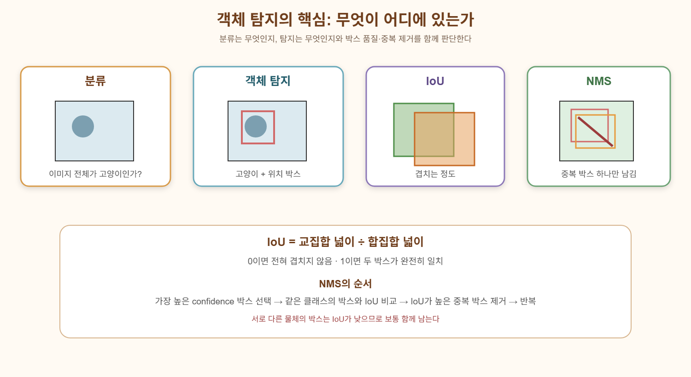
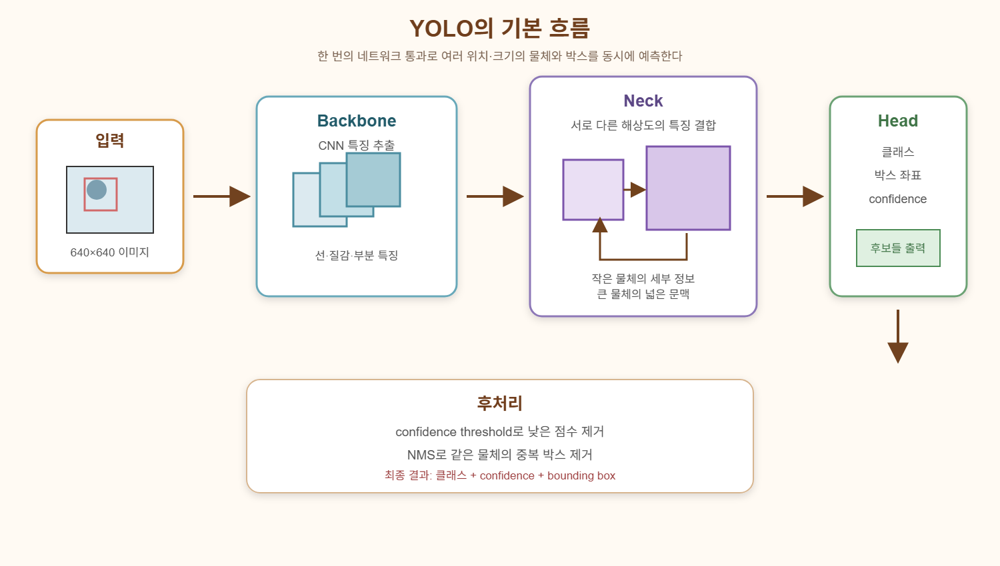

# 분류와 객체 탐지의 차이
## 이미지 분류
이미지 하나를 보고 전체 이미지의 클래스를 정함

이미지 안에 고양이가 몇 마리 있는지, 어디에 있는지는 안알려줌

## 객체 탐지
이미지안의 객체를 각각 찾는다

즉 객체 탐지는 결과가 다음 세 가지로 구성됨\
클래스\
bounding box\
confidence

### Bounding Box
객체를 감싸는 직사각형
```
          (x_max,y_max)
|---------------*
|               |
|               |
|       * center|
|               |
|               |
*---------------|
(x_min,y_min)
```
#### XYXY 방식
[x_min, y_min, x_max, y_max]
#### XYWH 방식
[x_center, y_center, width, height]
#### YOLO 라벨 방식
class_id\
x_center\
y_center\
width\
height

좌표를 이미지 크기로 나누어 0~1 사이로 정규화\
예를 들어 이미지 너비가 1,000이고 박스 중심 x가 500이면:
$$
x_{center}=\frac{500}{1000}=0.5
$$
<왜 좌표를 정규화할까?>

이미지 크기가 달라질 수 있기 때문

예를 들어 원본 이미지가 1,000×1,000이고 객체 중심이 x=500이라면 중심은 이미지의 절반\
이미지를 500×500으로 줄이면 중심 x는 250

절대좌표는 바뀌지만 상대적인 위치는 같음\
원본: x = 500 / 1000 = 0.5\
축소: x = 250 / 500  = 0.5

따라서 정규화된 좌표를 사용하면 이미지 크기가 바뀌어도 같은 라벨을 사용할 수 있음

이미지 크기와 무관하게
객체가 이미지의 어느 비율 위치에 있는가를 표현

단, 이미지에 단순 resize가 아니라 padding을 추가하는 letterbox를 적용하면 padding만큼 좌표를 이동해야 합니다. 실제 YOLO 라이브러리는 이런 변환을 내부적으로 처리합니다.
### IoU
Intersection over Union\
두 박스가 얼마나 겹치는지 측정하는 지표
$$
IoU=
\frac{\text{교집합 영역}}
{\text{합집합 영역}}
$$
#### 값의 의미
IoU = 0
→ 전혀 겹치지 않음

IoU = 0.5
→ 어느 정도 겹침

IoU = 1
→ 완전히 일치

예를 들어

정답 박스: 초록색\
예측 박스: 주황색

두 박스가 많이 겹칠수록 IoU가 높음

객체 탐지에서 예측이 맞았는지를 판단할 때 보통 다음조건을 함께 봄\
클래스를 맞혔는가?\
confidence가 충분히 높은가?\
IoU가 기준 이상인가?
### TP,FP,FN
분류에서는 단순히 정답을 맞췄는지만 보면 됨

객체탐지에서는 클래스와 위치를 동시에 봐야 함
#### TP
다음 세 가지 모두 만족
1. 객체가 실제로 존재함
2. 클래스를 맞힘
3. 박스가 충분히 정확함

e.g.\
정답: 얼룩말\
예측: 얼룩말\
IoU: 0.78 (IoU 기준이 0.5라면)
#### FP
모델이 있다고 했지만 실제 기준으로는 잘못된 경우
- 박스 위치가 틀림
- 클래스를 틀림
- 없는 객체를 있다고 예측
- 같은 객체를 여러 번 예측\
e.g. 실제로 얼룩말 한 마리가 있는데 박스 두 개가 나옴 -> 하나만 TP가 되고 나머지는 FP
#### FN
실제 객체가 있는데 모델이 탐지하지 못한 경우\
=> 놓침
### Confidence threshold
객체 탐지 모델은 각 예측에 confidence를 붙임

confidence threshold를 0.5로 정하면:
0.5 이상만 최종 결과로 사용

threshold를 높이면 ->
낮은 confidence 예측 제거\
=>
- FP감소
- Precision 증가
- FN 증가
- Recall 감소

threshold를 낮추면 ->
더 많은 박스를 남김\
=>
- 놓치는 객체 감소
- Recall 증가
- 잘못된 박스 증가
- Precision 감소
#### Precision
예측한것중 실제로 맞은 비율
#### Recall
실제 객체 중 모델이 찾아낸 비율
### AP와 mAP
객체 탐지에서는 단순 accuracy보다 AP와 mAP를 주로 사용
#### 왜 accuracy를 잘 사용하지 않는가?
객체 탐지에서는 이미지마다 객체 개수가 다르고, 박스 위치의 정확성도 평가해야 합니다.

따라서 단순히 이미지 전체가 맞았는지만 보는 accuracy는 적절하지 않습니다.
#### AP
Average Precision

confidence threshold 하나만 정해서 Precision과 Recall을 계산하는 것이 아닙니다.

threshold를 계속 바꿉니다.\
threshold = 0.95\
threshold = 0.90\
threshold = 0.85\
...\
threshold = 0.10

각 threshold마다 Precision과 Recall을 계산하고, Precision-Recall 그래프를 만듭니다.

세로축: Precision\
가로축: Recall

이 그래프 아래의 면적이 AP

=> confidence 기준을 어떻게 바꾸어도 Precision과 Recall을 얼마나 잘 유지하는가? 를 측정하는 값
#### mAP
클래스가 여러 개라면 클래스별 AP가 나옵니다.

이들의 평균이 mAP

mAP 뒤에 붙는 숫자는 IoU 기준

mAP@0.5 또는 mAP50 :\
IoU 기준을 0.5로 정하고 계산한 mAP\
IoU ≥ 0.5이면 TP

mAP@0.5:0.95 : IoU 기준을 여러 개 사용\
각 기준에서 AP를 구한 뒤 평균\
이 평가는 박스가 단순히 객체 주변에 있는지만 보는 것이 아니라, 객체를 얼마나 정밀하게 감싸는지도 평가함

따라서 보통\
mAP50은 높음\
mAP50-95는 상대적으로 낮음
# NMS
Non-Maximum Suppression

한 객체에 대해 여러 개의 후보 박스를 만들었을때 가장 적절한 박스 하나만 남기는 것
## 순서
1. confidence가 가장 높은 박스 선택
2. 같은 클래스의 다른 박스와 IoU계산
3. 선택한 박스와 IoU가 너무 높은 박스 제거
5. 반복

NMS가 사용하는 IoU는 정답 박스와 비교하는 것이 아님

평가 IoU:
예측 박스 vs Ground Truth

NMS IoU:
예측 박스 vs 다른 예측 박스

# YOLO
You Only Look Once

객체 탐지를 두 단계로 나누지 않고 한 번에 처리

2단계 탐지:\
후보 영역부터 찾자
→ 후보를 분류하자

YOLO:\
이미지 전체를 한 번 보면서
모든 위치에서 객체와 박스를 동시에 예측하자

한 번의 네트워크 계산으로 이미지 전체를 처리하기 때문에 빠름


이미지
→ CNN 특징 추출
→ 여러 위치에서 클래스와 박스 예측
→ confidence threshold
→ NMS
→ 최종 객체 목록
## Backbone
이미지에서 기본 특징을 추출함

=CNN의 feature extraction
## Neck
서로 다른 크기의 feature map을 섞습니다.

작은 해상도의 feature map은 넓은 영역의 문맥을 담습니다.

큰 해상도의 feature map은 작은 물체의 세부 정보를 담습니다.

Neck은 이 둘을 결합

## Head
최종적으로 예측

클래스\
박스 위치\
confidence 또는 분류 점수

### 예측값
박스는 보통 다음 네 방향의 거리로 표현할 수 있습니다.

왼쪽 거리: L\
위쪽 거리: T\
오른쪽 거리: R\
아래쪽 거리: B

어떤 기준점이 있을때\
기준점에서 왼쪽으로 L\
기준점에서 위쪽으로 T\
기준점에서 오른쪽으로 R\
기준점에서 아래쪽으로 B\
만큼 확장하면 예측 박스가 됨

YOLOv8 계열은 전통적인 사전 정의 anchor box에 의존하지 않는 anchor-free 방식을 사용

즉, 미리 여러 크기의 박스를 만들어 놓고 고르는 방식보다, 각 위치에서 박스 경계를 직접 예측하는 방향으로 발전했습니다.
## Loss
전체 loss
= classification loss + box regression loss(예측 박스가 정답 박스와 얼마나 다른지 계산 - CIoU) + distribution focal loss(박스 경계의 위치를 하나의 숫자로 단순히 예측하기보다, 가능한 위치들의 분포로 표현하여 더 정밀하게 학습하는 방식)
## NMS
YOLO는 한 이미지에서 수많은 후보 박스를 만듭니다.

예를 들어 8,400개 위치에서 예측이 나올 수 있습니다.

하지만 실제 최종 결과로 8,400개 박스를 모두 보여 주면 안 됩니다.

그래서 추론 과정은 다음처럼 진행됩니다.

8400개 후보 예측
→ confidence threshold로 낮은 점수 제거
→ NMS로 중복 박스 제거
→ 최종 박스 출력

“모델이 많은 후보를 만들고, 후처리에서 적절한 결과를 남긴다”
## 모델 크기
| 모델 | 속도 | 정확도 | 파라미터 |
|---|---|---|---|
| n(nano) | 빠름 | 상대적으로 낮음 | 적음 |
| s(small) | 빠른 편 | 개선됨 | 증가 |
| m(medium) | 중간 | 더 높음 | 증가 |
| l(large) | 느림 | 높음 | 많음 |
| x(extra large) | 가장 무거움 | 높을 수 있음 | 가장 많음 |

## dataset구조
Ultralytics YOLO는 보통 data.yaml 파일로 데이터셋 정보를 전달
```
path: 데이터셋 루트 폴더
train: images/train
val: images/val

names:
  0: zebra
  1: elephant
  2: giraffe
```
이 파일은 모델에게 다음을 알려 줍니다.

학습 이미지가 어디 있는가?\
검증 이미지가 어디 있는가?\
클래스 번호와 이름이 무엇인가?

각 이미지에는 대응되는 라벨 텍스트 파일이 있습니다.

이미지:
images/train/image001.jpg\
라벨:
labels/train/image001.txt

라벨 한 줄은 객체 하나를 의미합니다.

class_id x_center y_center width height

예:
0 0.52 0.48 0.31 0.42

이는 클래스 0 객체가 이미지 중앙 근처에 있고, 이미지 너비의 31%, 높이의 42% 크기라는 뜻
## 주요 설정
학습할 때 중요한 설정은 다음입니다.
```
epochs
imgsz
batch
model
data
```
### imgsz
입력 이미지 크기

640
→ 640×640으로 학습
### model
YOLO의 크기와 사전학습 가중치를 결정
### data
data.yaml 파일의 위치
## 학습 결과 해석
### Box loss
박스 위치가 정답과 얼마나 다른지
### Classification loss
클래스를 얼마나 잘 맞히는지
### DFL loss
박스 경계 예측의 분포가 얼마나 정확한지
### Precision
예측한 박스 중 실제로 맞은 비율
### Recall
실제 객체 중 모델이 찾아낸 비율
### mAP50
IoU 기준 0.5에서의 평균 탐지 성능
### mAP50-95
더 엄격한 여러 IoU 기준에서 평균낸 성능

이상적인 학습:\
loss ↓\
precision ↑\
recall ↑\
mAP ↑

학습 loss만 줄고 validation mAP가 더 이상 좋아지지 않는다면 과적합을 의심해야 합니다.
## Confusion Matrix
e.g.\
얼룩말을 말로 자주 분류\
코끼리를 코뿔소로 자주 분류

이를 통해 단순히 성능이 낮다에서 끝나지 않고 어떤 클래스끼리 혼동하는가? 를 알 수 있음
## 결과 직접 보기
숫자만 봐서는 모델이 왜 틀렸는지 알기 어렵습니다.

그래서 validation 이미지에 예측 박스를 그려 확인해야 합니다.

객체 탐지에서는 정량 지표와 시각적 결과를 함께 봐야 합니다.

## 전체 흐름
```
이미지
  ↓
resize / normalization
  ↓
YOLO Backbone
  ↓
여러 크기의 feature map 추출
  ↓
Neck에서 feature map 결합
  ↓
Head에서 각 위치별 클래스·박스 예측
  ↓
confidence threshold 적용
  ↓
NMS로 중복 박스 제거
  ↓
최종 객체 목록
```
최종 결과
```
[
  {
    class: zebra,
    confidence: 0.91,
    box: [x1, y1, x2, y2]
  },
  {
    class: elephant,
    confidence: 0.84,
    box: [x1, y1, x2, y2]
  }
]
```
