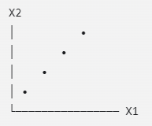
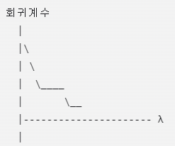

# Multicollinearity
## 다중공선성이란?
설명변수들 사이에 강한 건형관계가 있는 현상
$$
\operatorname{cor}(X_1,X_2)
$$
### Perfect Multicollinearity
어떤 설명변수가 다른 설명변수들의 정확한 선형결합이면 완전 다중공선성

e.g.
$$
X_3=2X_1+X_2
$$
설계행렬 X의 열들이 linearly dependent이므로 $
X'X
$의 역행렬을 구할 수 없음 -> OLS추정량 $\hat\beta=(X'X)^{-1}X'Y
$을 계산할 수 없음

dummy variable trap도 완전다중공선성의 예
### Near Multicollinearity
설명변수들이 매우 비슷한 경우\
e.g.
$$
X_2\approx 2X_1
$$
이 경우 $X'X$의 역행렬은 계산할 수 있지만, 추정값이 불안정해짐
## 다중공선성이 왜 문제인가?
1. 회귀계수의 표준오차 증가
2. t검정에서 유의하지 않게 보일 수 있음\
실제로는 Y와 관련이 있는 변수인데 개별 t검정에서는 유의하지 않게 나올 수 있음
3. 계수의 부호가 이상해질 수 있음
4. 작은 자료 변화에 계수가 크게 변함\
관측값 몇개를 추가,제거했을때 회귀계수가 크게 변할 수 있음\
즉, 추정량이 unstable해짐
5. 해석이 어려워짐\
다중회귀에서 $\beta_1$은 다른 설명변수들을 고정했을 때 $X_1$의 효과\
그런데 $X_1$과 $X_2$가 거의 같은 정보를 가지고 있다면 “$X_2$를 고정한 상태에서 $X_1$만 변화”하는 상황이 실제 자료에 거의 존재하지 않을 수 있습니다.\
=> 계수의 partial effect를 해석하기 어려워짐
### 다중공선성이 있어도 예측은 잘될 수 있음
다중공선성은 개별 회귀계수의 해석과 추정에는 문제를 일으키지만 전체적인 예측이 반드시 나빠진다는 뜻은 아님

따라서 다중공선성의 문제는 주로 다음과 관련
- 개별 계수 해석
- 개별 t검정
- 변수의 중요성 판단
- 계수의 안정성
## 진단 방법
1. Correlation Matrix\
설명변수들 사이의 상관계수를 확인
$$
\operatorname{cor}(X_j,X_k)
$$

상관계수의 절댓값이 매우 크면 다중공선성을 의심할 수 있습니다.
하지만 상관행렬만으로는 충분하지 않습니다.
왜냐하면 한 변수와 다른 변수 하나 사이의 관계뿐 아니라, 여러 변수의 선형결합으로 설명되는 관계도 있기 때문입니다.

2. VIF\
Variance Inflation Factor. 가장 대표적인 진단도구

각 $X_j$를 나머지 설명변수들로 회귀

의미: 다른 설명변수들과의 선형관계 때문에 Xj의 분산이 얼마나 부풀려졌는가?\
e.g.
- 1: 다른 변수와 선형관계가 거의 없음
- 5: 분산이 약 5배 커짐(이상이면 주의)
- 10: 심각한 다중공선성을 의심하는 기준으로 자주 사용

3. Tolerance\
VIF의 역수

작을수록 다중공선성이 심함\
보통 0.2나 0.1보다 작으면 다중공선성 의심
## 해결 방법
무조건 변수를 제거하는 것은 아님
1. Variable Removal\
서로 거의 같은 정보를 갖는 변수 중 하나를 제거\
단점: 중요한 정보를 읽을 수 있음

2. Combining Variables\
비슷한 변수들을 합쳐 하나의 지수(index)나 점수로 만들 수 있음

3. 주성분회귀(PCR)\
Principal Component Regression\
상관된 설명변수들을 서로 독립적인 주성분으로 변환한 뒤 회귀분석 진행

4. Ridge Regression\
회귀계수가 너무 커지는 것을 방지하기 위해 패널티를 추가

5. LASSO Regression\
계수의 절댓값 합에 패널티를 주어 일부 계수를 정확히 0으로 만들 수 있음
# PCA,PCR
Principal Component Analysis, 주성분분석\
Principal Component Regression, 주성분회귀

PCA를 이용해 설명변수의 차원을 줄이고 다중공선성 완화
## PCA
원래 변수들을 새로운 변수로 변환
$$
X_1,X_2,X_3,X_4
\quad\longrightarrow\quad
Z_1,Z_2,Z_3,Z_4
$$
이 새로운 변수 Zj를 principal component라고 함

주성분들은 다음 특징을 가짐
- 서로 상관이 없음
- 첫 번째 주성분이 데이터의 변동을 가장 많이 설명
- 두 번째 주성분은 첫 번째와 독립적인 방향 중 변동을 가장 많이 설명
- 필요하면 일부 주성분만 선택 가능
### 기본 idea

데이터의 가장 큰 변동 방향은 대각선 방향\
-> 이 방향을 새로운 축으로 사용
### 수학적 표현
$$
Z_k=\sum_{j=1}^{p}a_{kj}X_j
$$
여기서 $a_{kj}$를 loading coefficient 또는 주성분 계수라고 합니다.
#### 주성분 계수의 조건
보통 길이가 1이 되도록 정규화
$$
\sum_{j=1}^{p}a_{kj}^2=1
$$
e.g.
$$
Z_1=0.7X_1+0.7X_2
$$
$$
0.7^2+0.7^2=0.98
$$
실제로는 정확히 1이 되도록 계수를 정한다
### First Principal Component
다음 조건을 만족하는 선형결합임
- 분산이 가장 큰 선형결합
$$
Var(Z_1)
$$
이 최대가 되도록 계수들을 선택. 
단, 계수들이 무한히 커지는 것을 막기 위해 다음 조건을 둠
$$
\sum_{j=1}^{p}a_{1j}^2=1
$$
### 두번째 이후 주성분
첫 번째 주성분과 상관이 없어야함
$$
Cov(Z_1,Z_2)=0
$$
이 조건 아래에서 분산이 가장 큰 방향을 선택
$$
Var(Z_2)
$$
세 번째 주성분은 다음 조건을 만족
$$
Cov(Z_1,Z_3)=0
$$
$$
Cov(Z_2,Z_3)=0
$$
그리고 남은 방향 중 분산이 가장 큰 방향

$\therefore$주성분들의 분산은 일반적으로 다음 순서이다
$$
Var(Z_1)\geq Var(Z_2)\geq\cdots\geq Var(Z_p)
$$
### Eigenvalue와 Eigenvector
PCA는 covariance matrix 또는 correlation matrix의 고유값과 고유백터를 이용한다.
#### Eigenvector
주성분의 방향 결정
$$
a_1,a_2,\ldots,a_p
$$
각 고유벡터의 원소들이 주성분의 계수 또는 loading
#### Eigenvalue
각 주성분이 설명하는 분산의 크기를 나타냄
$$
\lambda_1\geq\lambda_2\geq\cdots\geq\lambda_p
$$
- $
\lambda_1$에 대응하는 고유벡터 -> 첫 번째 주성분
- $
\lambda_2$에 대응하는 고유백터 -> 두 번째 주성분
### 설명분산비율
각 주성분이 전체 변동 중 얼마를 설명하는지 계산 가능
$$
\text{Explained Variance Ratio}_k
=
\frac{\lambda_k}
{\lambda_1+\lambda_2+\cdots+\lambda_p}
$$
### 누적 설명분산
주성분을 몇 개 사용할지 결정할 때 확인
$$
\text{Cumulative EV}_k
=
\frac{\lambda_1+\cdots+\lambda_k}
{\lambda_1+\cdots+\lambda_p}
$$
보통 기준
- 누적 설명분산 80%이상
- 누적 설명분산 90%이상
- Scree plot에서 급격히 꺾이는 지점
- 교차검증 성능이 가장 좋은 지점

단, 설명분산이 높다고 반드시 Y예측에 가장 유리한건 아님
### Standardization의 필요성
PCA는 변수의 단위에 영향을 받음

-> 각 변수를 표준화
$$
X_j^*
=
\frac{X_j-\bar X_j}{s_j}
$$
표준화하면 각 변수는 다음 측정을 갖는다
$$
\bar X_j^*=0,\qquad s_{X_j^*}=1
$$
표준화한 변수로 PCA를 수행하면 공분산행렬 대신 상관행렬을 사용하는 것과 비슷한 효과가 있음
### PCA와 회귀분석의 차이
PCA는 Y를 사용하지 않음\
X들만 보고 새로운 축을 만듬\
=> PCA는 비지도학습 방법

반면 회귀분석은 Y를 예측하는 것이 목적\
=> X와 Y를 사용

PCA가 가장 큰 분산 방향을 찾는다고 해서 그 방향이 반드시 Y를 잘 예측하는 방향은 아님
## PCR
### Step 1
PCA수행
원래 설명변수들을 주성분으로 변환
$$
X_1,\ldots,X_p
\longrightarrow
Z_1,\ldots,Z_p
$$
### Step 2
선택한 주성분으로 회귀

선택한 q개의 주성분을 사용하여 회귀분석
$$
Y
=
\theta_0+\theta_1Z_1+\cdots+\theta_qZ_q+\epsilon
$$
$$
q\leq p
$$
원래 변수 p개를 모두 사용하지 않고, 설명분산이 큰 주성분 q개만 사용하면 차원을 줄일 수 있습니다.
### 장점
1. 다중공선성 완화

주성분들은 서로 상관이 없음

2. 차원 축소

p개의 설명변수를 q개의 주성분으로 줄일 수 있음

3. 예측 안정성 향상

작은 고유값에 해당하는 방향은 계수 추정이 불안정할 수 있음. 해당 주성분을 제거하면 예측이 더 안정적일 수 있음
### 단점
Y와의 관계를 고려하지 않고 주성분을 선택한다

설명변수의 변동을 많이 설명하는 방향과 반응변수를 잘 예측하는 방향은 다를 수 있다\
-> PCR에서 주성분 개수는 단순히 설명분산만 보고 결정하기보다 cross validation을 사용할 수 있음
## PCA와 PCR의 차이
| 구분 | PCA | PCR |
|---|---|---|
| 목적 | 설명변수의 차원 축소 | 주성분을 이용한 회귀 |
| Y 사용 여부 | 사용하지 않음 | 사용함 |
| 주성분 선택 기준 | X의 분산 | 예측 성능 또는 교차검증 |
| 학습 유형 | 비지도학습 | 지도학습 |
| 다중공선성 | 주성분 사이에는 없음 | 완화됨 |
# Ridge Regression
회귀계수가 지나치게 커지는 것을 막아 다중공선성 문제를 완화함
## OLS의 문제
$$
\min_{\beta_0,\ldots,\beta_p} SSE
$$
설명변수들이 강하게 상관되어 있으면 여러 계수 조합이 비슷한 적합값을 만들 수 있음\
e.g.
$$
10X_1-9X_2
$$
or
$$
5X_1-4X_2
$$
## 기본 idea
Ridge Regression은 SSE만 최소화하지 않음. 계수의 크기가 너무 커지는 것도 penalty를 줌
$$
\min_{\beta_0,\beta_1,\ldots,\beta_p}
\left\{
SSE+\lambda\sum_{j=1}^p\beta_j^2
\right\}
$$
이를 L2 penalty라 함
- SSE: 데이터에 맞지 않는 정도
- $\sum_{j=1}^p\beta_j^2$: 회귀계수 크기의 제곱합
- $\lambda$: 벌점의 강도를 조절하는 tuning parameter

절편은 보통 벌점에 포함하지 않는다
### $\lambda$의 의미
#### $\lambda$가 작을 때
계수의 크기를 조금만 줄임
#### $\lambda$가 클 때
계수들이 0에 가까워짐
#### $\lambda$->$\infty$
절편을 제외한 회귀계수들이 거의 0에 가까워짐\
하지만 일반적으로 정확히 0이 되지는 않음
## OLS와 Ridge의 차이
| 구분 | OLS | Ridge |
|---|---|---|
| 목적함수 | SSE 최소화 | $SSE+\lambda\sum\beta_j^2$ 최소화 |
| 계수 | 데이터에 최대한 맞춤 | 계수를 0 방향으로 축소 |
| 다중공선성 | 불안정할 수 있음 | 안정성이 향상됨 |
| 계수 해석 | 상대적으로 직접적 | 축소 편향이 있어 주의 |
| 변수선택 | 하지 않음 | 일반적으로 하지 않음 |
| $\lambda$ | 없음 | 선택해야 함 |
## 왜 계수를 줄이면 도움이 되는가?
Ridge는 약간의 bias를 허용하는 대신 variance를 줄임\
Ridge는 계수를 축소하여
- 추정값의 변동을 줄이고
- 작은 자료 변화에 덜 민감하게 만들며
- 예측을 안정화한다

=> bias-variance trade-off\
OLS: bias 큼, 분산 큼\
Ridge: 편향 조금 있음, 분산 작음

예측 목적에서는 Ridge가 더 유리할 수 있음
## Ridge 제약조건의 관점
### Penalized form
$$
\min
\left\{
SSE+\lambda\sum_{j=1}^p\beta_j^2
\right\}
$$
### Constrained form
$$
\min SSE
\quad
\text{subject to}
\quad
\sum_{j=1}^p\beta_j^2\leq t
$$
- $\lambda$가 클수록 계수 크기를 강하게 제한
- t가 작을수록 계수 크기를 강하게 제한
## 변수 표준화
Ridge는 계수의 크기에 벌점을 줍니다.
그런데 설명변수의 단위가 다르면 계수의 크기를 직접 비교하기 어렵습니다.
변수의 단위만 바꾸어도 회귀계수의 크기가 달라집니다. 그러면 어떤 변수에 더 강한 벌점이 적용되는지가 단위에 따라 달라집니다.
따라서 Ridge를 적용할 때는 보통 설명변수를 표준화합니다.
$$
X_j^*
=
\frac{X_j-\bar X_j}{s_j}
$$
$$
\bar X_j^*=0,\qquad s_{X_j^*}=1
$$
## 절편은 왜 표준화하지 않거나 벌점에서 제외할까?
회귀모형의 절편은 변수의 평균 수준을 나타냄. 절편까지 벌점을 주면 모형 전체 수준 자체가 불필요하게 0쪽으로 끌려갈 수 있음
## 변수 제거?
일반적으로 Ridge는 변수를 완전히 제거하지 않는다

보통
$$
\hat\beta_j\approx 0
$$
이 되지만,
$$
\hat\beta_j=0
$$
이 되지는 않습니다.

=> Ridge는 variable selection보다는 coefficient shrinkage방법
## Ridge Trace
$\lambda$를 변화시키면서 각 회귀계수가 어떻게 변하는지 그린 그래프

- $\lambda$=0: OLS 계수와 동일
- $\lambda$증가: 계수가 0방향으로 축소
- 매우 큰 $\lambda$: 계수들이 거의 0
- 계수의 변동이 점점 안정됨
## $\lambda$는 어떻게 선택?
너무 작게 선택: OLS와 거의 같아져 다중공선성 완화 표과가 작다

너무 크게 선택: underfitting이 발생할 수 있음

=> cross validation으로 선택
### k-fold 교차검증
1. 데이터를 K개 그룹으로 나눔
2. K-1개 그룹으로 학습
3. 남은 그룹에서 예측오차 계산
4. 이 과정 반복
5. 여러 $\lambda$에 대해 병균 예측오차 비교
6. 예측오차가 가장 작은 $\lambda$ 선택
$$
CV(\lambda)
=
\text{평균 검증 오차}
$$
를 최소화하는 $\lambda$선택
## 장단점
### 장점
- 다중공선성 완화
- 회귀계수 안정화
- 예측 성능 향상 가능
- 모든 변수를 유지하면서 정보를 활용
- p>n인 경우에서도 사용할 수 있음 (설명변수 개수가 관측값 개수보다 많은 경우)
### 단점
- 계수가 편향됨
- 계수해석이 OLS보다 어려움
- 변수를 자동으로 제거하지 않음
- $\lambda$를 선택해야함
- 변수 표준화가 중요함
# LASSO Regression
다중공선성을 완화하면서 동시에 일부 회귀계수를 정확히 0으로 만들어 변수를 선택할 수 있는 방법
## LASSO란?
Least Absolute Shrinkage and Selection Operator
$$
\min_{\beta_0,\ldots,\beta_p}
\left\{
SSE+\lambda\sum_{j=1}^{p}|\beta_j|
\right\}
$$
- $\lambda$: 벌점의 강도
- $\lambda\sum|\beta_j|$: L1 penalty

따라서 LASSO는 L1 정규화(L1 regularization)라고도 합니다.

LASSO는 다음 두 가지를 동시에 수행
1. coefficient shrinkage
2. variable selection
## $\lambda$선택
데이터가 자동으로 결정x\
cross validation사용
$$
CV(\lambda)
=
\text{교차검증 평균 오차}
$$
### 최소오차 기준
교차검증 오차가 가장 작은 
$\lambda$를 선택
### 1-SE기준
최소오차와 거의 비슷한 성능을 가지면서 더 큰 $\lambda$, 즉 더 단순한 모형을 선택

=>
- $\lambda_{\min}$: 예측오차 최소화
- $\lambda_{1SE}$: 비슷한 성능 중 더 적은 변수 선택
## 장점
1. 변수선택 가능
2. 모형을 단순하게 만듦
3. 다중공선성 완화
4. p>n상황에서 사용가능\
OLS는 일반적으로 이런 상황에서 문제가 생기지만, LASSO는 정규화 덕분에 적용할 수 있습니다.
## 단점
1. 계수에 편향이 생김
2. 상관된 변수 중 일부만 선택할 수 있음
3. 변수선택이 불안정할 수 있음
4. 모든 중요한 변수를 반드시 선택하는 것은 아님

# 비교
| 구분 | PCR | Ridge | LASSO |
|---|---|---|---|
| 기본 아이디어 | 주성분 선택 | 계수 축소 | 계수 축소 + 변수선택 |
| 벌점 | 없음 | L2 | L1 |
| 모든 원래 변수 사용 | 보통 X | O | 선택된 변수만 |
| 계수 정확히 0 | 주성분 단위로 제거 | 보통 X | O |
| 다중공선성 처리 | 주성분 변환 | 안정화 | 축소 및 선택 |
| 해석 | 주성분 해석 필요 | 원래 변수 해석 가능 | 선택 변수 중심 해석 |
| 상관변수 처리 | 주성분으로 결합 | 함께 유지하는 경향 | 일부만 선택하는 경향 |