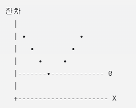
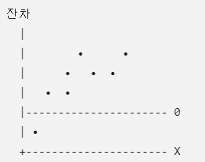
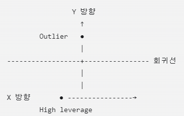

# Simple Linear Regression

## Simple Linear Regression이란?
하나의 설명변수 X를 이용하여 하나의 반응변수 Y의 평균적인 변화를 직선으로 설명하거나 예측하는 방법이다
- Y: 반응변수(response variable), 종속변수(dependent variable)
- X: 설명변수(explanatory variable), 독립변수(independent variable), 예측변수(predictor)

e.g.\
-공부시간 X로 시험점수 Y를 설명\
-광고비 X로 판매량 Y를 예측\
-경력 X로 연봉 Y를 설명
$$
Y=\beta_0+\beta_1X+\varepsilon
$$

## Covariance
두 변수가 함께 어떻게 변하는지를 나타내는 값 (방향)\
선형관계만을 측정 (X,Y가 비선형적인 방식으로 관여되있을 수 있음)
### 기본 아이디어
1. 각 관측값이 평균에서 얼마나 떨어져 있는지를 봄 (편차)
$$
y_i-\bar{y},\ x_i-\bar{x}
$$
2. 두 편차의 곱을 생각
$$
(y_i-\bar{y})(x_i-\bar{x})
$$
- X와 Y가 동시에 평균보다 크거나 동시에 작으면 곱이 양수
- 하나는 평균보다 크고 다른 하나는 작으면 곱이 음수

### 표본 공분산
$$
\operatorname{cov}(X,Y)
=
\operatorname{cov}(Y,X)
=
\frac{1}{n-1}
\sum_{i=1}^{n}
(x_i-\bar{x})(y_i-\bar{y})
$$
- $x_i, y_i$: $i$번째 관측값 $(i=1,\ldots,n)$
- $\bar{x}, \bar{y}$: 각각 $X, Y$의 표본평균 ($\mu_X, \mu_Y$: 각각 $X, Y$의 모집단평균)
- $n$: 관측값의 개수
- $n-1$: 자유도
### 부호 해석
부호는 Y와 X사이 선형 관계의 방향을 나타냄\
if cov(X,Y)>0, a positive relationship between Y and X\
if cov(X,Y)<0, a negative relationship between Y and X\
if cov(X,Y)=0, no linear relationship between Y and X

But, 공분산의 크기를 보고 관계의 강도를 비교하면 안됨.\
공분산은 측정 단위가 바뀌면 값도 변하기 때문\
e.g.\
-키, cm/m -> 실제 관계는 같지만 공분산의 값은 달라짐\
-소득을 원 단위로 측정하다가 만 원 단위로 바꾸면 공분산 값도 바뀜

=> 관계의 강도를 비교할 땐 단위의 영향을 제거한 상관계수(correlation coefficient)를 사용
## Correlation coefficient
공분산의 단위 문제를 해결하기 위해 X와 Y를 표준화 한 뒤 공분산을 계산한 것\
관계의 방향과 강도 모두 나타냄\
측정단위가 바뀌어도 변하지 않음\
선형관계만을 측정 (X,Y가 비선형적인 방식으로 관여되있을 수 있음)

### standardize the data
$$
z_{y,i}=\frac{y_i-\bar{y}}{s_y}
$$

$$
z_{x,i}=\frac{x_i-\bar{x}}{s_x}
$$
- Z has mean=0 and sd=1
- $s_y$: the sample standard deviation of Y
- $s_x$: the sample standard deviation of X
$$
s_y
=
\sqrt{
\frac{1}{n-1}
\sum_{i=1}^{n}
(y_i-\bar{y})^2
}
$$
$$
s_x
=
\sqrt{
\frac{1}{n-1}
\sum_{i=1}^{n}
(x_i-\bar{x})^2
}
$$
### standardized X and Y
$$
\operatorname{cor}(Y,X)
=
\frac{1}{n-1}
\sum_{i=1}^{n}
\left(
\frac{y_i-\bar{y}}{s_y}
\right)
\left(
\frac{x_i-\bar{x}}{s_x}
\right)
=
\frac{cov(Y,X)}{s_ys_x}
$$
$$
=r_{XY}
=
\frac{1}{n-1}
\sum_{i=1}^{n}
z_{x,i}z_{y,i}
$$
$
-1 \le cor(Y,X) \le 1
$
### 해석
- 부호는 방향 나타냄
- -1 또는 1에 가까울수록 Y와 X사이의 선형관계가 더 강해짐
- if cor(Y,X)=0, no linear relationship between Y and X
### 특징
- 대칭적
$$Cor(X,Y)=Cor(Y,X)$$
X와 Y의 역할이 구분되지 않음
- 인과관계를 의미하지 않음

상관계수가 높다고 해서 X가 Y의 원인이라는 뜻은 아님

## Simple Linear Regression Model
$$
Y=\beta_0+\beta_1X+\varepsilon
$$
- $\beta_0,\beta_1$: parameter
- $\varepsilon$: error

Each observation\
$
y_i=\beta_0+\beta_1x_i+\varepsilon_i,\ i
$=1,2,...,n
## 상관계수와 회귀의 차이
| 구분 | 상관계수 | 회귀분석 |
|---|---|---|
| 목적 | 선형관계의 방향·강도 측정 | X로 Y 설명·예측 |
| 변수 역할 | X,Y가 대칭적 (둘 다 중요) | X와 Y의 역할이 다름 (Y가 더 중요) |
| 결과 | 단위 없는 하나의 수 | 절편과 기울기를 가진 식 |
| 인과관계 | 증명하지 못함 | 단독으로 인과관계를 증명하지 못함 |

단순회귀에서는 기울기의 부호와 상관계수의 부호가 같음\
: $\hat{\beta}_1$는 $Cov(Y,X),Cor(Y,X)$와 항상 같은 부호
$$
\hat{\beta}_1
=
\frac{\operatorname{cov}(Y,X)}
{\operatorname{Var}(X)}
=
\operatorname{cor}(Y,X)
\frac{s_y}{s_x}
$$
## Parameter Estimation
$Estimate\ parameter\ \beta_0\ and\ \beta_1$\
goal: 반응변수와 예측변수에 대한 산점도의 점들을 가장 잘 대표하는 line찾기
### LSM(Least Squares Method)
The parameters are estimated using the least squares method
$$
\min_{\beta_0,\beta_1}
\sum_{i=1}^{n}
(y_i-\hat{y}_i)^2
$$
#### fitted value
회귀직선으로 계산한 Y의 값
$$
\hat y_i=\hat\beta_0+\hat\beta_1x_i
$$
#### 잔차(residual)
실제 점과 회귀직선 사이의 수직거리(vertical distance)

즉, 실제값과 fitted value의 차이
$$
e_i=y_i-\hat y_i
$$
잔차의 합은 0\
$\therefore$ 잔차를 제곱해서 더한다

$
\sum_{i=1}^{n}e_i^2
$ : SSE (Sum of Squared Errors)

즉, 모든 점과 직선 사이의 수직거리 제곱의 합이 가장 작아지는 직선을 찾는다

즉, 최소제곱법은 SSE를 최소화하는 방법이다
## 회귀계수 공식
$$
\hat\beta_1
=
\frac{\sum(x_i-\bar x)(y_i-\bar y)}
{\sum(x_i-\bar x)^2}
=
\frac{\operatorname{Cov}(X,Y)}
{\operatorname{Var}(X)}
$$
$$
\hat\beta_0=\bar y-\hat\beta_1\bar x
$$
=> 최소제곱 회귀직선은 항상 평균점$
(\bar x,\bar y)
$을 지남

## 계산 예시
$$ 
X=(1,2,3),\qquad Y=(2,3,5)
$$
평균
$$
\bar x=2,\qquad \bar y=\frac{10}{3}
$$
편차의 곱
$$ 
\sum(x_i-\bar x)(y_i-\bar y)=3
$$
$$
\sum(x_i-\bar x)^2=2
$$
$
\therefore
\hat\beta_1=\frac{3}{2}=1.5
$

절편은

$$
\hat\beta_0=\frac{10}{3}-1.5(2)
=\frac13
$$
$$\therefore\hat Y=\frac13+1.5X
$$
해석: X가 1 증가할 때 Y의 평균적인 예측값은 약 1.5 증가한다
### fitted value 계산
$$
\hat y_1=\frac13+1.5(1)=1.833
$$
$$
\hat y_2=\frac13+1.5(2)=3.333
$$
$$
\hat y_3=\frac13+1.5(3)=4.833
$$
### residual 계산
$$
e_1=2-1.833=0.167
$$
$$
e_2=3-3.333=-0.333
$$
$$
e_3=5-4.833=0.167
$$
## 오차와 잔차의 차이
| 구분 | 오차(error) | 잔차(residual) |
|---|---|---|
| 기호 | $\epsilon_i$ | $e_i$ |
| 정의 | 실제 회귀직선과 관측값의 차이 | 추정된 회귀직선과 관측값의 차이 |
| 기준 | 모집단의 참된 직선 | 표본으로 적합한 직선 |
| 관측 가능 여부 | 직접 알 수 없음 | 계산 가능 |
$$
\epsilon_i=y_i-(\beta_0+\beta_1x_i)
$$
$$
e_i=y_i-(\hat\beta_0+\hat\beta_1x_i)
$$
## $\hat\beta_0$, $\hat\beta_1$이 얼마나 믿을 만한 추정값인가?
표본을 바꾸면 $\hat\beta_0$, $\hat\beta_1$도 달라짐. 따라서 추정량에는 변동이 있음
### 회귀계수의 분산
$\hat{\beta}$이 표본에 따라 얼마나 변하는지를 알아야하는데 그 퍼진 정도를 나타내는 것이 $Var(\hat{\beta})$
#### 기울기 추정량의 분산
$$
\operatorname{Var}(\hat{\beta}_1)
=
\frac{\sigma^2}
{\displaystyle\sum_{i=1}^{n}(x_i-\bar{x})^2}
$$
#### 절편 추정량의 분산
$$
\operatorname{Var}(\hat{\beta}_0)
=
\sigma^2
\left[
\frac{1}{n}
+
\frac{\bar{x}^{\,2}}
{\displaystyle\sum_{i=1}^{n}(x_i-\bar{x})^2}
\right]
$$
### 오차분산의 추정
실제 $\sigma^2$는 알 수 없기 때문에 잔차로 추정한다

$Var(\varepsilon_i)=\sigma^2$\
-> $\sigma$(오차의 모집단 표준편차)는 데이터가 회귀직선 주변에 얼마나 퍼져 있는지를 나타내는 값. 하지만 실제로는 알 수 없는 값이기 때문에 데이터로 추정해야 한다.
$$
\hat{\sigma}^{\,2}
=
\frac{\operatorname{SSE}}{n-2}
\ (
\operatorname{SSE}
=
\sum_{i=1}^{n}e_i^2
=
\sum_{i=1}^{n}(y_i-\hat{y}_i)^2)
$$
왜 n-2로 나눌까?\
단순선형회귀에서 표본으로 추정한 모수가 2개이기 때문
- $\beta_0$추정
- $\beta_1$추정

따라서 자유도(degrees of freedom)은 n-2이다
### 표준오차
Standard error, SE는 추정량의 표준편차를 추정한 값\
표본이 바뀔 때 추정값이 얼마나 흔들리는가를 나타내는 수치
$$
\operatorname{SE}(\hat{\beta}_1)
=
\frac{\hat{\sigma}}
{\sqrt{\displaystyle\sum_{i=1}^{n}(x_i-\bar{x})^2}}
$$

$$
\operatorname{SE}(\hat{\beta}_0)
=
\hat{\sigma}
\sqrt{
\frac{1}{n}
+
\frac{\bar{x}^{\,2}}
{\displaystyle\sum_{i=1}^{n}(x_i-\bar{x})^2}
}
$$
**표준오차가 작을수록 $\hat{\beta_0}$, $\hat{\beta_1}$이** 표본에 따라 크게 흔들리지 않고 **더 정밀함**

=> 다음 상황에서 작아짐
1. 오차의 변동 $\hat{\sigma}$가 작을 때
2. X의 관측값들이 넓게 퍼져 있을 때
3. 표본 크기 n이 충분히 클 때
#### 표준오차와 표준편차의 차이
| 구분 | 표준편차(SD, standard deviation) | 표준오차(SE, standard error) |
|---|---|---|
| 측정 대상 | 개별 데이터의 퍼짐 | 추정량의 불확실성 |
| 질문 | 데이터가 얼마나 흩어져 있는가? | 추정값이 얼마나 정확한가? |
| 사용 | 기술통계(descriptive statistics) | 추론통계(inferential statistics) |
| 표본 크기 영향 | 직접적인 영향이 작음 | 표본이 커지면 보통 작아짐 |
- **SD**: 하나의 표본 안에서 관측값들이 평균 주변에 얼마나 퍼져 있는지 나타내는 값
- **SE**: 여러 표본을 반복해서 뽑았을 때, 표본평균이나 회귀계수 같은 추정값이 얼마나 변하는지 나타내는 값

예를 들어 시험점수의 표준편차는 학생들 점수의 퍼짐을 나타냄\
반면 시험 평균의 표준오차는 표본을 반복해서 뽑았을 때 표본평균이 얼마나 달라지는지를 나타냄

회귀분석에서는 $\bar X$ 대신 $\hat{\beta}_0,\hat{\beta}_1$ 같은 회귀계수 추정값이 여러 표본에서 얼마나 달라지는지를 표준오차로 측정한다

## Hypothesis Testing
### Assumptions (선형회귀의 기본가정)
1. Linearity\
X와 Y의 평균적인 관계가 직선이어야 한다
$$
E(Y\mid X=x)=\beta_0+\beta_1x
$$
2. IID\
independent and identically distributed\
오차들이 서로 독립이고 같은 분산을 가져야 한다
$$
E(\epsilon_i)=0
$$
$$
\operatorname{Var}(\epsilon_i)=\sigma^2
$$
3. normality\
오차가 정규분포를 따른다고 가정한다
$$
\epsilon_i\sim N(0,\sigma^2)
$$

### 기울기에 대한 가설검정
#### 검정의 목적
설명변수 X가 반응변수 Y를 선형적으로 설명하는데 유용한지 확인
$$
H_0:\beta_1=0
$$
$$
H_1:\beta_1\neq0
$$
#### 귀무가설 $H_0$
$$
\beta_1=0
$$
X가 Y를 설명하는 데 선형적으로 유의한 도움이 없다
- 주의할 점: X랑 Y가 아무런 관계도 없다는 뜻이 아니라, **선형관계가 없다**는 뜻\
곡선 관계는 여전히 존재할 수 있음
#### 검정통계량
$$
t=
\frac{\hat\beta_1}
{SE(\hat\beta_1)}
$$
자유도
$
df=n-2
$
인 t분포를 따름\
왜 $n-2$일까?
- $\beta_0$ 추정에 자유도 1개 사용
- $\beta_1$ 추정에 자유도 1개 사용
#### 기각 방법
- 임계값(critical value)을 이용하는 방법

양측검정(two-sided test)이므로
$$
|t|\ge t_{n-2,\alpha/2}
$$
이면 $H_0$를 기각
- p-value를 이용하는 방법
$$
p\text{-value}<\alpha
$$
이면 $H_0$를 기각

만약 기각 못시키면 accept $H_0$가 아니라 fail to reject $H_0$임. $H_0$가 참이라고 말할 수 없음\
-> '선형관계가 없다고 확정하는 것이 아니라, 선형관계가 있다고 판단할 충분한 증거가 없다'라고 표현해야 함
### 상관계수에 대한 가설검정
상관계수로도 같은 검정을 할 수 있음
$$
H_0:\rho=0
$$
$$
H_1:\rho\neq0
$$
- $\rho$: 모집단 상관계수(population correlation)
- $r$: 표본 상관계수(sample correlation)
#### 검정통계량
$$
t=
\frac{r\sqrt{n-2}}
{\sqrt{1-r^2}}
$$
자유도 n-2

즉, 단순선형회귀에서는 기울기 검정과 상관계수 검정이 본질적으로 같은 결론을 줍니다.
단, 이는 단순선형회귀 상황에서의 관계입니다. 다중회귀에서는 단순상관계수만으로 특정 변수의 효과를 판단할 수 없습니다.
## 회귀계수의 신뢰구간
기울기 $\beta_1$의 $100(1-\alpha)\%$ 신뢰구간은
$$
\boxed{
\hat\beta_1
\pm
t_{n-2,\alpha/2}
SE(\hat\beta_1)
}
$$
절편의 신뢰구간은
$$
\boxed{
\hat\beta_0
\pm
t_{n-2,\alpha/2}
SE(\hat\beta_0)
}
$$
### 신뢰구간의 해석
예를 들어 $\beta_1$의 95% 신뢰구간이
(1.2, 3.8)
이라면
**모집단의 기울기 $\beta_1$이 95% 신뢰수준에서 1.2와 3.8 사이에 있다고 추정한다**
## 예측과 평균반응 추정
새로운 $X=x_0$가 주어졌다\
이때 밑의 두 가지를 구분해야 함
1. 개별 관측값의 예측\
특정한 한 사람 또는 한 사건의 Y를 예측\
e.g. 공부시간이 5시간인 특정 학생의 시험점수는 얼마인가?
2. mean response 추정\
$X=x_0$인 모든 대상의 평균 Y를 추정\
e.g. 공부시간이 5시간인 학생들의 평균 시험점수는 얼마인가?

두 경우 모두 점 추정값은 같음
$$
\hat y_0
=
\hat\beta_0+\hat\beta_1x_0
$$
하지만 구간은 다름
| 경우 | 점 추정값 | 구간 |
|---|---|---|
| 평균반응 추정 | $\hat\mu_0=\hat y_0$ | 평균반응의 신뢰구간(confidence interval) |
| 개별 관측값 예측 | $\hat Y_0=\hat y_0$ | 예측구간(prediction interval) |

신뢰구간: 평균반응을 추정하는 구간
$$
\boxed{
\hat y_0
\pm
t_{n-2,\alpha/2}
SE(\hat\mu_0)
}
$$
예측구간: 새 개별 관측값을 예측하는 구간
$$
\boxed{
\hat y_0
\pm
t_{n-2,\alpha/2}
SE_{\text{prediction}}
}
$$
$$
\text{prediction interval}
>
\text{confidence interval}
$$
why?\
평균반응 추정은 여러 관측값의 평균을 구하는 것이므로 개별적인 오차가 어느 정도는 상쇄됨. 반면 개별 관측값 예측은 다음 두 가지 불확실성을 모두 포함
1. 회귀직선을 추정하는 불확실성
2. 새 관측값 자체의 오차
## 적합도와 $R^2$
회귀식을 구한 뒤에는 회귀식이 데이터를 얼마나 잘 설명하는지 평가해야 함
#### 총제곱합
$$
SST=\sum(y_i-\bar y)^2
$$
total sum of squares\
Y가 평군 주변에서 얼마나 변하는지를 나타냄
#### 회귀제곱합
$$
SSR=\sum(\hat y_i-\bar y)^2
$$
sum of squares due to regression\
회귀식이 설명한 변동
#### 잔차제곱합
$$
SSE=\sum(y_i-\hat y_i)^2
$$
sum of squared errors\
회귀식이 설명하지 못한 변동
$$
\boxed{
SST=SSR+SSE
}
$$
Y의 전체 변동
= 회귀식이 설명한 변동 + 회귀식이 설명하지 못한 변동
### $R^2$
$R^2$는 결정계수(coefficient of determination) 또는 적합도 지수(goodness-of-fit index)
$$
R^2=\frac{SSR}{SST}
=1-\frac{SSE}{SST}
$$
Y의 전체 변동 중에서 회귀모형이 설명하는 비율

단순선형회귀에서는 $R^2=r^2$도 성립
#### 해석 시 주의점
- $R^2$가 높다고 인과관계는 아님\
: 설명력이 높아도 X가 Y의 원인이라고 확정할 수 없음
- $R^2$가 낮다고 모형이 반드시 쓸모없는 것은 아님\
: 현실의 자료엔 오차가 많을 수 있어서 $R^2$가 낮아도 기울기가 유의하거나 예측 목적에 유용할 수 있음
- 변수의 개수가 늘면 $R^2$는 보통 증가함\
(이 내용은 다중회귀에서 더 중요하게 다룸)
## 절편이 없는 회귀모형
일반적인 모형은
$$
Y=\beta_0+\beta_1X+\epsilon
$$
이지만, 절편을 0으로 고정하는 모형도 있음
$$
Y=\beta_1X+\epsilon
$$
이를 no-intercept regression model 또는 regression through the origin이라고 함
### 언제 사용하는가?
이론적으로 X=0이면 반드시 Y=0이어야 하는 경우

e.g.
- 시간 X=0에서 이동거리 Y=0
- 사용량 X=0에서 비용 Y=0
### 기울기 추정량
$$
\hat\beta_1
=
\frac{\sum x_iy_i}{\sum x_i^2}
$$
### 주의점
절편이 없는 모형은 단순히 절편의 p-value가 크다고 해서 선택하면 안됨

반드시
- 이론적으로 원점을 지나야 하는가?
- 두 모형의 잔차제곱합이 어떻게 다른가?
- 실제 문제의 맥락에 맞는가?

를 확인해야 함

또한, 절편이 없으면 일반적인 회귀모형의 성질 일부가 달라짐
- 회귀직선이 $(\bar x,\bar y)$를 반드시 지나지 않음
- 잔차의 합이 반드시 0이 아님
- $R^2$ 해석이 일반 모형과 달라질 수 있음
## 설명변수가 없는 회귀모형
$$
Y_i=\beta_0+\epsilon_i
$$
이때 최적의 $\hat\beta_0$는 표본평균이다.
$$
\hat\beta_0=\bar y
$$
즉, 설명변수가 없는 회귀모형은 평균만으로 모든 관측값을 예측하는 모형임
### 일표본 t검정
$\beta_0$이 특정 값인지 검정\
설명변수가 없는 회귀모형에서 절편 $\beta_0$는 모집단 평균 $\mu$와 같으므로, $\beta_0=\mu_0$에 대한 검정은 일표본 t검정과 동일

따라서
$$H_0:\beta_0=\mu_0$$
을 검정하는 일표본 t검정(one-sample t-test)은 다음 통계량을 사용
$$
t=
\frac{\bar y-\mu_0}{s_Y/\sqrt n}
$$
자유도는
$$
df=n-1
$$

### 대응표본 t검정
같은 사람을 대상으로 실험 전후를 비교하는 경우가 있음\
예:
- 다이어트 전 체중$Y_1$
- 다이어트 후 체중$Y_2$

각 사람의 차이를 정의한다
$$
D_i=Y_{1i}-Y_{2i}
$$
그 다음 차이 $D_i$에 대해 일표본 t검정을 실시\
다이어트로 체중이 감소했는지 검정한다면:
$$
H_0:\mu_D=0
$$
$$
H_1:\mu_D>0
$$
즉, 대응표본 t검정(paired two-sample t-test)은 사실상 차이값에 대한 일표본 t검정

=> 일표본 t검정과 대응표본 t검정은 선형회귀모형의 특수한 경우이다\
 The one-sample t-test and paired two-sample t-test are special cases of the linear regression model.
 # Multiple Linear Regression
 ## Multiple Linear Regression이란?
 simple linear regression은 설명변수가 하나\
 multiple linear regression은 설명변수가 두 개 이상인 회귀이다
$$
Y=\beta_0+\beta_1X_1+\beta_2X_2+\cdots+\beta_pX_p+\epsilon
$$
- $\beta_0$: intercept
- $\beta_j$: $X_j$의 부분 회귀계수(partial regression coefficient)

관측값 i에 대해서는
$$
Y_i=\beta_0+\beta_1x_{i1}+\cdots+\beta_px_{ip}+\epsilon_i
$$
라고 씀
## 다중회귀가 필요한 이유
예를 들어 연봉 Y를 경력 X1과 학력 X2로 설명한다고 하자
$$
Y=\beta_0+\beta_1X_1+\beta_2X_2+\epsilon
$$
경력만 사용하면 학력의 영향을 무시하게됨

다중회귀에서는 학력이 같은 사람끼리 비교했을때 경력이 연봉에 미치는 영향을 추정할 수 있음\
-> 다중회귀의 핵심인 **다른 변수들을 일정하게 유지한 상태에서(holding other variables constant)** 의 해석
## Parameter Estimation
#### fitted value
$$
\hat y_i
=
\hat\beta_0+\hat\beta_1x_{i1}
+\cdots+
\hat\beta_px_{ip}
$$
#### residual
$$
e_i=y_i-\hat y_i
$$
### OLS(ordinary least squares)
다음 잔차제곱합을 최소화한다
$$
SSE
=
\sum_{i=1}^{n}e_i^2
=
\sum_{i=1}^{n}
\left(
y_i-\beta_0-\beta_1x_{i1}
-\cdots-\beta_px_{ip}
\right)^2
$$
즉, 여러 설명변수를 이용하여 관측값과 적합값 사이의 제곱거리 합이 최소가 되는 계수들을 찾는다

행렬ver
$$
\hat{\boldsymbol\beta}
=
(X^\mathsf{T}X)^{-1}X^\mathsf{T}Y
$$
단, $X^\mathsf{T}X$가 역행렬을 가져야 합니다. 설명변수 사이에 완전한 선형관계가 있으면 이 계산이 불가능해집니다.
## 회귀계수의 해석
다중회귀계수의 해석에는 반드시 “다른 변수들을 일정하게 유지할 때”가 들어간다.\
e.g.
$$
\hat Y
=
15.3276+0.7803X_1-0.0502X_2
$$
### $X_1$의 계수
$$
\hat\beta_1=0.7803
$$
#### 의미
$X_2$를 일정하게 유지할 때, $X_1$이 1 증가하면 $Y$의 평균적인 값이 0.7803 증가한다

### $X_2$의 계수
$$
\hat\beta_2=-0.0502
$$
#### 의미
$X_1$을 일정하게 유지할 때, $X_2$가 1 증가하면 $Y$의 평균적인 값이 0.0502 감소한다.
### "다른 변수를 고정한다"는 뜻
다른 변수의 영향이 섞이지 않도록 비교한다는 뜻
### 부분 회귀계수
다중회귀계수는 partial regression coefficient라고도 한다

예를 들어 $X_2$의 계수를 구한다고 합시다.
1. Y를 $X_1$에 회귀하여 $X_1$로 설명되지 않는 Y의 잔차를 구함
2. $X_2$를 $X_1$에 회귀하여 $X_1$로 설명되지 않는 $X_2$의 잔차를 구함
3. 두 잔차를 서로 회귀함

이때 나오는 기울기가 원래 다중회귀에서의 $X_2$ 계수와 같습니다.

즉, $X_1$의 선형적인 영향을 Y와 $X_2$ 양쪽에서 제거한 뒤 $X_2$의 고유한 효과를 보는 것입니다.

$\beta_j$는 다른 설명변수를 일정하게 유지했을 때 $X_j$의 부분효과이다.
## 중심화(centering)
중심화는 각 변수에서 평균을 빼는 것입니다.
$$
X_j^c=X_j-\bar X_j
$$
$$
Y^c=Y-\bar Y
$$
중심화된 변수의 평균은 0입니다.
$$
\overline{X_j^c}=0
$$
### 효과
중심화하면 회귀계수의 기울기들은 대체로 그대로 유지되지만 절편의 해석이 달라짐

원래 절편:
모든 $X_j=0$일 때의 평균 Y

중심화 후 절편:
모든 설명변수가 평균 수준일 때의 평균 Y

따라서 X=0이 현실적으로 의미없는 경우 중심화하면 절편을 더 자연스럽게 해석할 수 있음
## 척도화(scaling)
변수의 단위나 크기를 조정하는 것
### standardization
$$
Z_j=
\frac{X_j-\bar X_j}{s_j}
$$
평균=0, 표준편차=1
## 왜 중심화와 표준화를 하는가?
### 단위의 영향을 줄이기 위해
예를 들어 소득을 원 단위로 측정할 때와 만 원 단위로 측정할 때 회귀계수의 숫자는 달라짐.

하지만 변수의 단위가 달라졌다고 실제 관계가 변한것은 아님
### 계수의 크기를 비교하기 위해
표준화하면 모든 변수가 같은 척도에 놓임

예를 들어 표준화된 회귀계수는 **해당 설명변수가 1 표준편차 증가할 때 Y가 몇 표준편차 변화하는가** 를 나타냄

따라서 서로 단위가 다른 설명변수들의 상대적인 영향력을 비교하기 쉬워짐

주의할 점: 중심화와 표준화가 다중공선성을 근본적으로 없애려는 것은 아님. 단위와 해석을 정리하는 데 도움을 주지만 설명변수 사이의 실제 상관관계 자체를 제거하지는 않음
## 다중 상관계수와 결정계수
다중회귀에서는 Y와 여러 설명변수의 관계를 적합값 $\hat{Y}$를 통해 평가함
### multiple correlation coefficient
$$
R=\operatorname{cor}(Y,\hat Y)
$$
### 결정계수
여러 설명변수가 함께 설명하는 Y의 변동 비율
$$
R^2
=
\frac{SSR}{SST}
=
1-\frac{SSE}{SST}
$$
해석: Y의 전체 변동중 $X_1,\ldots,X_p$가 함께 설명하는 비율

단순회귀에서는 $
R^2=r^2
$였지만, 다중회귀에서는 여러 변수를 함께 사용하므로 특정 하나의 상관계수 제곱과 같지 않음
### 조정 $R^2$
설명변수를 추가하면 SSE가 줄어들거나 같아짐. 따라서 $R^2$는 변수를 추가할수록 감소하지 않는다.

하지만 의미없는 변수를 추가해도 $R^2$가 증가할 수 있음

이를 보완하기 위해 adjusted $R^2$를 사용한다
$$
R_a^2
=
1-
\frac{SSE/(n-p-1)}
{SST/(n-1)}
$$
또는
$$
R_a^2
=
1-
\frac{n-1}{n-p-1}(1-R^2)
$$
조정 $R^2$는 설명변수의 개수에 대한 penalty를 포함함\
따라서
- 의미 있는 변수를 추가하면 증가할 수 있음
- 의미가 약한 변수를 추가하면 감소할 수 있음

주의할 점: 조정 $R^2$는 일반적인 $R^2$처럼 Y의 변동 중 몇 %를 설명한다고 직접 해석하면 안됨
#### 자유도
다중선형회귀에서 모수는 다음과 같이 총 p+1개임
- 절편 $\beta_0$ 1개
- 설명변수 계수 $\beta_1,\ldots,\beta_p$ p개

따라서 잔차 자유도는 
$$
df=n-p-1
$$
## Hypothesis Testing
다음 네 가지를 검정함
1. 개별 회귀계수 하나
2. 모든 회귀계수
3. 일부 회귀계수의 묶음
4. 회귀계수 사이의 관계 또는 제약조건

### 1. 개별 회귀걔수 검정: t검정
#### 검정 목적
특정 설명변수 $X_j$가 다른 변수들을 통제한 상태에서 Y에 유의한 영향을 주는지 검정한다
$$
H_0:\beta_j=\beta_{j,0}
$$
$$
H_1:\beta_j\neq\beta_{j,0}
$$
보통은
$$
\beta_{j,0}=0
$$
으로 두므로,
$$
H_0:\beta_j=0
$$
을 검정합니다.
#### 검정통계량
$$
t_j=
\frac{\hat\beta_j-\beta_{j,0}}
{SE(\hat\beta_j)}
$$
#### 해석
$H_0$을 기각하면 '다른 모든 설명변수를 일정하게 유지했을 때 Xj는 Y와 통걔적으로 유의한 선형관계를 가진다'라고 해석함

기각하지 못하면 'Xj의 효과가 없다고 확정하는 것이 아니라, 다른 변수들을 통제한 상태에서 $\beta_j\neq0$라고 판단할 충분한 근거가 없다'라고 해석
### 2. 전체 회귀모형 검정: F검정
#### 검정 목적
설명변수들을 모두 함께 사용했을 때, 모형 전체가 설명력을 가지는지 검정합니다
$$
H_0:\beta_1=\beta_2=\cdots=\beta_p=0
$$
$$
H_1:\text{적어도 하나의 }\beta_j\neq0
$$
$H_0$: 모든 설명변수는 설명력이 없다\
$H_1$: 적어도 하나의 설명변수는 설명력이 있다
#### 완전모형과 축소모형
full model, FM\
모든 설명변수를 포함
$$
Y=\beta_0+\beta_1X_1+\cdots+\beta_pX_p+\epsilon
$$
reduced model, RM\
귀무가설이 참이라고 가정하여 일부 계수를 제한한 모형

전체 F검정에서는 모든 기울기를 0으로 제한하므로 축소모형은 $
Y=\beta_0+\epsilon
$이다. 즉, 절명변수 없이 평균만 사옹하는 모형. 

축소모형은 완전모형의 특수한 경우이므로 내포모형(nested model)이다
#### F통계량의 원리
완전모형은 변수가 더 많기 때문에 축소모형보다 SSE가 작거나 같음
$$
SSE(FM)\le SSE(RM)
$$
두 모형의 SSE차이가 크다면 RM이 너무 많은 설명력을 버리고 있다는 뜻
#### F통계량
$$
F=
\frac{
\left[SSE(RM)-SSE(FM)\right]/(p+1-k)
}{
SSE(FM)/(n-p-1)
}
$$
여기서 k는 축소모형의 모수 개수
#### ANOVA
Analysis of Variance
| 변동원 | 제곱합 | 자유도 | 평균제곱 | F |
|---|---:|---:|---:|---:|
| 회귀(regression) | SSR | p | MSR=SSR/p | MSR/MSE |
| 잔차(error) | SSE | n-p-1 | MSE=SSE/(n-p-1) |  |
| 합계(total) | SST | n-1 |  |  |
$$
SST=SSR+SSE
$$
$$
(n-1)=p+(n-p-1)
$$
$$
\boxed{
F=\frac{MSR}{MSE}
}
$$
직관
- MSR: 모형이 설명한 변동의 평균 크기
- MSE: 설명되지 않고 남은 오차의 평균 크기
$$
F=\frac{\text{설명된 변동}}{\text{남은 오차}}
$$
F가 크면 -> '설명변수들이 전혀 설명력이 없다는 귀무가설과 잘 맞지 않는다'라고 해석
#### 전체 F검정과 $R^2$
$$
F=
\frac{R^2/p}
{(1-R^2)/(n-p-1)}
$$
->
- $R^2$가 클수록 F가 커지는 경향
- p가 많다지면 같은 $R^2$에서도 F가 달라짐
- 표본 크기 n도 F검정 결과에 영향을 줌

$R^2$가 크다고 해서 모든 개별 계수가 유의한 것은 아님
### 3. 일부 회귀계수에 대한 검정: F검정
#### 검정 목적
설명변수가 많을 때 일부 변수들을 제거해도 되는지 검정

예를 들어 $X_1,X_3$만 남기고 싶은 경우\
완전모형:
$$
Y=\beta_0+\beta_1X_1+\beta_2X_2+\cdots+\beta_6X_6+\epsilon
$$
축소모형:
$$
Y=\beta_0+\beta_1X_1+\beta_3X_3+\epsilon
$$
검정가설
$$
H_0:\beta_2=\beta_4=\beta_5=\beta_6=0
$$
#### 부분 F검정(partial F-test)
완전모형에 p개의 설명변수, 축소모형에 q개의 설명변수
$$
F=
\frac{
\left[SSE(RM)-SSE(FM)\right]/(p-q)
}{
SSE(FM)/(n-p-1)
}
$$
해석
- F가 크고 p-value가 작음\
-> 제거한 변수들이 추가적인 설명력을 제공함\
-> 축소모형이 부적절할 수 있음
- F가 작고 p-value가 큼\
-> 제거한 변수들이 추가적인 설명력을 제공한다고 보기 어려움\
-> 축소모형을 사용해도 무방하다고 판단\
단, 여기서도 RM이 참이라고 증명 하는것은 아님
#### $R^2$을 이용한 부분 F검정
완전모형의 결정계수를 $R_p^2$, 축소모형의 결정계수를 $R_q^2$라고 하면,
$$
F=
\frac{
(R_p^2-R_q^2)/(p-q)
}{
(1-R_p^2)/(n-p-1)
}
$$
따라서 부분 F검정은 다음을 묻습니다.\
새로 추가된 p-q개의 변수들이 설명력을 충분히 증가시켰는가?
### 4. 두 회귀계수의 동일성 검정
두 걔수가 같은지 검정\
e.g.
$$
H_0:\beta_1=\beta_3
$$
다른 계수들은 0이라고 가정하면 완전모형은
$$
Y=\beta_0+\beta_1X_1+\beta_3X_3+\epsilon
$$
귀무가설 $\beta_1=\beta_3$가 성립하면,
$$
\beta_1X_1+\beta_3X_3
=
\beta_1(X_1+X_3)
$$
$$
W=X_1+X_3
$$
라고 새 변수를 정의하면 축소모형은
$$
Y=\beta_0+\beta_1W+\epsilon
$$
### 4. 선형 제약조건 검정
e.g.
$$
H_0:\beta_1+\beta_3=1
$$
X1과 X3가 같은 양만큼 증가할 때 Y가 총 1만큼 증가한다\
general linear hypothesis
일반적으로는
$$
H_0:C\boldsymbol\beta=\mathbf d
$$
형태로 표현
### 네 가지 검정 비교
| 검정 | 귀무가설 | 방법 |
|---|---|---|
| 개별 계수 검정 | $H_0:\beta_j=0$ | t검정 |
| 전체 모형 검정 | $H_0:\beta_1=\cdots=\beta_p=0$ | F검정 |
| 일부 계수 검정 | $H_0:\beta_{j_1}=\cdots=\beta_{j_k}=0$ | 부분 F검정 |
| 계수 관계 검정 | $H_0:\beta_1=\beta_3$, $\beta_1+\beta_3=1$ 등 | t 또는 F검정 |
# Model Diagnostics
"이 회귀모형을 믿어도 되는가?"\
회귀분석은 기본가정이 적절하다는 전제에서 검정과 신뢰구간을 사용할 수 있음
### 회귀모형의 기본가정 복습
1. Linearity\
반응변수의 평균이 설명변수들의 선형결합으로 표현된다는 가정. 주의할 점은 설명변수 자체가 반드시 직선적으로 생겼다는 뜻이 아니라 linear in parameters라는 의미
$
Y=\beta_0+\beta_1X+\beta_2X^2+\epsilon
$도 선형모형. parameters에 대해서는 선형이기 때문
2. independence(오차의 독립성)
3. mean zero\
오차의 평균이 0
4. 등분산성\
모든 관측값에서 오차의 분산이 같아야함
5. Normality\
오차가 정규분포를 따름
## Residual plot
잔차를 그래프로 그려서 모형의 문제를 확인

좋은 잔차 플롯:
- 0을 중심으로 random으로 흩어져 있음
- 특별한 곡선 패턴이 없음
- 퍼짐의 정도가 일정함
- 특정 관측값만 지나치게 크지 않음

반대로 패턴이 나타나면 회귀모형의 가정이 위반되었을 가능성이 있음
### 주요 패턴
#### 1. 곡선 패턴: 선형성 위반

잔차가 곡선 모양을 보이면 X와 Y의 관계가 직선이 아닐 수 있음

예를 들어 실제 관계가
$$
Y=\beta_0+\beta_1X+\beta_2X^2+\epsilon
$$
인데 단순히
$$
Y=\beta_0+\beta_1X+\epsilon
$$
로 적합했을 수 있습니다.

해결
- $X^2$ 추가
- log transformation
- 제곱근 변환
- 다른 비선형 모형 사용
#### 2. 깔때기 모양: 등분산성 위반

$
Var(\epsilon_i)
$
가 일정하지 않다는 뜻\
->
heteroscedasticity

해결
- Y에 로그 변환 적용
- WLS(Weighted Least Squares)
- 이분산성에 강건한 표준오차(robust standard errors)사용
- 변수의 척도나 모형 재검토
#### 3. 군집 패턴: 독립성 위반 가능성
잔차가 시간이나 순서에 따라 비슷한 형태로 움직이면 독립성이 의심됨

연속된 시점에서 잔차가 비슷한 부호를 가진다면 autocorrelation이 있을 수 있음

해결
- time series model
- GLS(Generalized Least Squares)
- 자기상관을 고려한 표준편차
## Standardized Residual
잔차는 변수의 단위와 관측값에 따라 크기가 달라질 수 있음. 따라서 잔차를 표준화해서 비교
$$
r_i
=
\frac{e_i}
{\hat\sigma\sqrt{1-p_{ii}}}
$$
- $\hat\sigma$: 오차 표준편차 추정값
- $p_{ii}$: 레버리지(leverage)

표준화잔차는 "이 관측값의 잔차가 일반적인 잔차보다 몇 표준편차만큼 큰가?"를 보여줌

일반적인 기준(경험적)
- $|r_i|>2$: 주의할 관측값
- $|r_i|>3$: 이상치(outlier) 가능성이 큼
### Leverage
설명변수 공간에서 특정 관측값이 얼마나 독특한 위치에 있는지를 나타냄\
=> X값이 다른 관측값들과 비교해 얼마나 멀리 떨러져 있는가?

$x_i$가 $\bar x$에서 멀수록 $p_{ii}$가 커짐
#### 잔차와의 관계
높은 레버지리 관측값은 회귀선을 자기쪽으로 끌러당길 수 있음. 그럼 오히려 자신의 잔차는 작게 나타날 수도 있음

=> 잔차가 작다고 해서 영향력이 없는것은 아님
#### 이상치, 높은 레버리지, 영향력 있는 관측값
| 개념 | 기준 | 핵심 질문 |
|---|---|---|
| 이상치(Outlier) | Y 방향으로 비정상적 | 잔차가 큰가? |
| 높은 레버리지(High leverage) | X 공간에서 비정상적 | 설명변수 값이 멀리 있는가? |
| 영향력 있는 관측값(Influential observation) | 모형 결과를 크게 변화시킴 | 제거하면 회귀선이 크게 바뀌는가? |

## Cook's Distance
관측값 i가 전체 회귀모형에 얼마나 영향을 주는지 측정하는 대표적인 지표
$$
C_i
=
\frac{
\sum_{j=1}^{n}
(\hat y_j-\hat y_{j(i)})^2
}
{\hat\sigma^2(p+1)}
$$
$$
C_i
=
\frac{r_i^2}{p+1}
\frac{p_{ii}}{1-p_{ii}}
$$
1. 잔차가 큰가?
2. 레버리지가 큰가?

를 반영. 따라서 둘다 크면 Cook's distance가 커질 가능성이 높음
$$
C_i>1
$$
이면 영향력이 큰 관측값
## 문제가 있는 관측값을 발견하면 바로 삭제?
NO\
이상치나 영향력 있는 관측값을 발견했다고 해서 자동으로 제거하면 안됨\
먼저 다음을 확인
1. Data entry error\
데이터 입력 오류
2. Sampling problem\
표본추출 문제: 특정집단만 비정상적으로 포함되었거나 모집단을 대표하지 않을 수 있음
3. 실제로 중요한 특수 집단인가?
4. 모형이 잘못되었는가?

가능한 조치
- 오류라면 수정
- 필요하면 관측값 제외
- 가중치 조정
- 변수 변환
- 비선형항 추가
- 다른 회귀모형 사용
- 더 많은 데이터 수집
# Qualitative Variables as Predictors
X가 연속형이 아니고 범주형일때. 현실에선 X가 범주형일때가 더 많음. (Y가 범주형이면 모형자체가 달라짐)

범주형 변수를 회귀분석에 넣을 때는 dummy variable을 사용
## 더미변수
범주가 두 개라면 더미변수 하나만 있으면 됨\
e.g.
$$
D=
\begin{cases}
0 & \text{남성}\\
1 & \text{여성}
\end{cases}
$$
$$
Y_i=\beta_0+\beta_1D_i+\epsilon_i
$$
남성 집단: D=0
$$
Y_i=\beta_0+\beta_1(0)+\epsilon_i
$$
$$
E(Y|D=0)=\beta_0
$$
따라서 $\beta_0$는 남성 집단의 평균

여성 집단: D=1
$$
Y_i=\beta_0+\beta_1(1)+\epsilon_i
$$
$$
E(Y|D=1)=\beta_0+\beta_1
$$
따라서 여성 집단의 평균은 $\beta_0+\beta_1$

두 집단 평균의 차이
$$
E(Y|D=1)-E(Y|D=0)=\beta_1
$$
즉,
더미변수의 회귀계수 $\beta_1$은 기준집단과 해당 집단의 평균 차이이다.
## Reference Group
더미변수에서 D=0인 집단을 기준집단 또는 참조집단이라고 함
## 범주가 3개 이상인 경우
범주가 k개이면 일반적으로 더미변수 k-1개를 사용

e.g. 지역 3 종류
| 지역 | $D_1$: 서울 | $D_2$: 부산 |
|---|---:|---:|
| 서울 | 1 | 0 |
| 부산 | 0 | 1 |
| 대전 | 0 | 0 |

이때 대전이 기준집단
$$
Y_i=\beta_0+\beta_1D_{1i}+\beta_2D_{2i}+\epsilon_i
$$
더미변수 k개 만들면 perfect multicollinearity 생김. 그래서 k-1개(dummy variable trap)
## 범주형 변수와 연속형 변수를 함께 사용하는 경우
e.g.
- X: 공부시간
- D: 성별 더미변수
-
$$
D=
\begin{cases}
0 & \text{남성}\\
1 & \text{여성}
\end{cases}
$$
$$
Y_i=\beta_0+\beta_1X_i+\beta_2D_i+\epsilon_i
$$
남성: D=0
$$
E(Y|X,D=0)=\beta_0+\beta_1X
$$
여성: D=1
$$
E(Y|X,D=1)
=
\beta_0+\beta_1X+\beta_2
$$
두 집단의 기울기는 동일, 절편만 다름
- $\beta_1$: 공부시간이 1시간 늘어날 때 평균 점수의 변화량
- $\beta_2$: 같은 공부시간에서 여성과 남성의 평균 점수 차이

이 모형은 **공분산분석(ANCOVA, Analysis of Covariance)** 과 연결됨
### Interaction
집단에 따라 공부시간의 효과 자체가 다를 수 있습니다.
예를 들어 공부시간이 증가할수록 남성의 점수는 크게 증가하지만, 여성의 점수는 조금만 증가할 수 있습니다.
이 경우 두 집단의 회귀선이 평행하지 않습니다.
이를 표현하려면 상호작용항(interaction term)을 추가합니다.
$$
Y_i
=
\beta_0+\beta_1X_i+\beta_2D_i+\beta_3(X_iD_i)+\epsilon_i
$$
남성: D=0
$$
E(Y|X,D=0)
=
\beta_0+\beta_1X
$$
여성: D=1
$$
E(Y|X,D=1)
=
\beta_0+\beta_1X+\beta_2+\beta_3X
$$
-> 두 집단 간 기울기와 절편 다름
#### 상호작용 계수의 해석
$$
Y=\beta_0+\beta_1X+\beta_2D+\beta_3XD+\epsilon
$$
| 계수 | 의미 |
|---|---|
| $\beta_0$ | 기준집단에서 $X=0$일 때 평균 Y |
| $\beta_1$ | 기준집단의 X 기울기 |
| $\beta_2$ | X=0에서 두 집단의 평균 차이 |
| $\beta_3$ | 두 집단의 기울기 차이 |

$$
\beta_3
=
\text{여성의 기울기}-\text{남성의 기울기}
$$
다음을 검정 할 수 있음
$$
H_0:\beta_3=0
$$
- 기각하지 못함: 두 집단의 기울기가 다르다고 볼 충분한 근거가 없음
- 기각: 두 집단의 X-Y관계, 즉 기울기가 다르다고 판단할 근거가 있음
